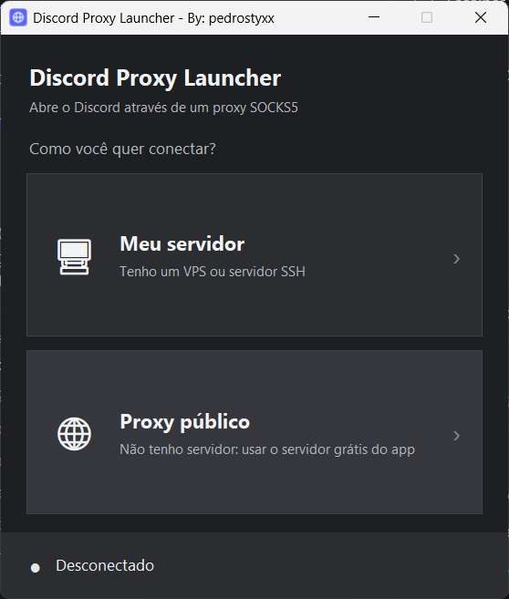

<p align="center">
  
</p>

<h1 align="center">Discord Proxy Launcher</h1>

<p align="center">
  Abre o Discord através de um proxy — o seu próprio servidor ou, sem servidor, o servidor dedicado gratuito<br>
  do app e proxies públicos, sempre fora do Brasil —, sem VPN, sem instalar nada e sem mexer no resto do computador.
</p>

<p align="center">
  <a href="https://github.com/pedrostyxx/discord-proxy-launcher/releases/latest/download/discord-proxy-launcher.exe">
    
  </a>
  <br>
  <sub>Windows 10 e 11 (64 bits) · arquivo único, sem instalação · <a href="https://github.com/pedrostyxx/discord-proxy-launcher/releases">todas as versões</a></sub>
</p>

<p align="center">
  
</p>

## Por que este app existe

Em algumas redes o Discord não funciona direito: fica preso em "Conectando...", cai a toda hora, fica lento ou
é simplesmente bloqueado — pela operadora, pela rede da empresa ou da faculdade, ou num Wi-Fi público.

A saída de costume é uma VPN, mas ela cobra um preço: desvia **todo** o tráfego do computador (e deixa o resto
da internet mais lento), precisa ser instalada e quase sempre é paga.

O **Discord Proxy Launcher** resolve só o que precisa ser resolvido: ele coloca **apenas o Discord** atrás de um
proxy. Não há nada para configurar — com um clique o app prepara o proxy, abre o Discord, fica de olho na
conexão e troca de proxy sozinho se ela cair.

## O que ele faz

Ao abrir, você escolhe um de dois modos:

|  | 🖥️ **Meu servidor** | 🌐 **Proxy público** |
|---|---|---|
| **Para quem** | tem um VPS ou servidor com SSH | não tem servidor |
| **O que você preenche** | o IP do servidor (porta, usuário e senha são opcionais) | nada |
| **Como funciona** | cria um túnel SSH até o seu servidor e passa o Discord por ele | usa o **servidor dedicado gratuito** oferecido por [pedrostyxx](https://www.instagram.com/pedrostyxx/) (saída na França); se ele estiver fora do ar, baixa listas de proxies SOCKS5 gratuitos, testa vários ao mesmo tempo e usa o mais rápido que sai fora do Brasil |
| **Se a conexão cair** | reconecta o túnel sozinho (até 3 tentativas) | passa para os proxies públicos (e volta ao servidor dedicado quando ele voltar), sem fechar o Discord |
| **Estabilidade** | a do seu servidor — a melhor opção | a do servidor dedicado; os proxies gratuitos de reserva caem com frequência e o app troca sozinho |

Nos dois modos:

- **Monitor de conexão.** A cada 30 segundos o app confere se o proxy continua respondendo. Duas falhas
  seguidas disparam a reconexão ou a troca de proxy. Se quem caiu foi a sua internet (Wi-Fi, notebook voltando
  da suspensão), ele espera a conexão voltar em vez de trocar de proxy à toa.
- **Discord sempre no proxy.** Se o Discord se atualizar e reiniciar sozinho (voltando sem o proxy), o app
  percebe e o reabre pelo proxy.
- **Status sempre à vista.** Uma linha colorida no rodapé mostra o que está acontecendo:
  🔵 conectando · 🟡 testando proxies · 🟢 proxy ativo · 🟠 trocando proxy · 🔴 erro · ⚪ desconectado.

## Só o Discord passa pelo proxy

O app **não** liga o proxy do Windows, não cria VPN e não altera nenhuma configuração do sistema. Ele abre o
Discord com a opção `--proxy-server` do próprio Discord (que é feito em Electron/Chromium), e essa opção vale
**só para o Discord**:

- navegador, jogos, downloads e todos os outros programas continuam usando a sua conexão normal, na velocidade
  de sempre;
- ao clicar em **Parar** (ou fechar o app), o Discord aberto por ele é fechado; da próxima vez que você o abrir
  pelo atalho, ele volta ao normal, sem proxy.

## Chamadas e compartilhamento de tela funcionam normalmente

O proxy leva o "Discord de texto": login, mensagens, servidores, canais, imagens e o carregamento do app. Já o
áudio e o vídeo das **chamadas de voz, das câmeras e do compartilhamento de tela (Go Live)** seguem pela conexão
de mídia do próprio Discord, direto para os servidores de voz.

Na prática: **chamadas e compartilhamento de tela funcionam tranquilamente**, sem ficar lentos ou travando por
causa do proxy — mesmo com os proxies gratuitos. O teste de latência com que o Discord escolhe a região de voz e
do Go Live (`latency.discord.media`) sai direto pela sua conexão, para que ele escolha servidores perto de você, e
não perto do proxy (veja [Limitações](#limitações)).

> **Bom saber:** como as chamadas não passam pelo proxy, os servidores de voz do Discord veem o seu IP real
> durante uma chamada. E, enquanto o app usa o **servidor dedicado**, também saem direto pela sua conexão o envio
> de anexos (que vai para o Google), as *Activities* (os jogos e apps dentro das chamadas) e as integrações, como
> YouTube e Spotify. Se o seu objetivo for esconder o IP, use o modo **Meu servidor**: ele leva todo o resto do
> Discord — só as chamadas ficam de fora.

## Como usar

1. **[Baixe o `discord-proxy-launcher.exe`](https://github.com/pedrostyxx/discord-proxy-launcher/releases/latest/download/discord-proxy-launcher.exe).**
   Não tem instalação: é um arquivo só.
2. **Abra o arquivo** e aceite o pedido de permissão do Windows — o app pede para rodar como administrador.
   - Se aparecer *"O Windows protegeu o computador"*, clique em **Mais informações → Executar assim mesmo**. O
     aviso aparece porque o executável ainda não tem assinatura digital (veja [Limitações](#limitações)).
3. **Escolha o modo:**
   - **Meu servidor:** digite o IP (ou o endereço) do servidor. A porta (22) e o usuário (root) já vêm
     preenchidos. Informe a senha ou deixe em branco para usar a sua chave SSH (`id_ed25519`, `id_ecdsa` ou
     `id_rsa` na pasta `.ssh` do seu usuário).
   - **Proxy público:** é só clicar em **Iniciar**. O app conecta no servidor dedicado e abre o Discord em
     poucos segundos. Se o servidor dedicado estiver fora do ar, ele baixa a lista, testa os proxies públicos e
     abre o Discord com o melhor em cerca de 15 a 30 segundos.
4. **Pronto.** O Discord abre pelo proxy. Deixe o app aberto (pode minimizar) — é ele quem vigia a conexão. Para
   voltar ao normal, clique em **Parar**.

## Telas

<p align="center">
  
</p>

<p align="center">
  
</p>

## Requisitos

- Windows 10 ou 11, 64 bits.
- Discord para desktop instalado (versão normal, PTB ou Canary — o app encontra a instalação sozinho).
- Para o modo **Meu servidor**: um servidor com SSH que permita encaminhamento de portas
  (`AllowTcpForwarding yes`, o padrão do OpenSSH).

## Perguntas frequentes

<details>
<summary><b>Isso é uma VPN?</b></summary>
<br>

Não. Uma VPN muda a rota de todo o computador. Aqui só o Discord usa o proxy; o resto continua igual.
</details>

<details>
<summary><b>O app guarda minha senha ou algum dado?</b></summary>
<br>

Não. Nada é gravado em disco (a não ser o log de diagnóstico, se você pedir um com `--log`; ele nunca contém
senhas): a senha SSH fica só na memória enquanto o app está aberto, e o app não cria configurações, serviços nem
arquivos de dados.
</details>

<details>
<summary><b>O que é o servidor dedicado?</b></summary>
<br>

Um servidor oferecido gratuitamente por **[pedrostyxx](https://www.instagram.com/pedrostyxx/)** — se o app te
ajudou, siga no Instagram como agradecimento. Ele fica fora do Brasil (na França), atrás da Cloudflare, e só
atende este app e só o Discord: não serve para navegar, baixar ou acessar outros sites.

Enquanto ele está em uso, o que não é do Discord (vídeos do YouTube e outras integrações, Spotify, as
*Activities*, o envio de anexos, que vai para o Google) sai direto pela sua conexão, como sem o app. O servidor vê o
seu IP e quais endereços do Discord são acessados, mas **não o conteúdo**, que continua criptografado. Ele não grava
nada disso (o log dele só tem totais, sem IPs nem endereços). A conexão passa pela Cloudflare, que também vê o seu
IP e o endereço do Discord acessado.

Numa ligação, cada pessoa se conecta ao Discord pela própria internet: para que tudo funcione para todos, quem
também estiver com o Discord bloqueado ou instável precisa estar com este app aberto.
</details>

<details>
<summary><b>Usar proxy público é seguro?</b></summary>
<br>

O tráfego do Discord é criptografado (HTTPS), então o dono do proxy não consegue ler suas mensagens nem sua
senha — e o app só aceita um proxy depois de conferir, através dele, o certificado do Discord. O dono do proxy
consegue ver que você está usando o Discord. Para mais privacidade e estabilidade, use o modo **Meu servidor**.
</details>

<details>
<summary><b>Por que o app pede para rodar como administrador?</b></summary>
<br>

Para conseguir fechar e reabrir o Discord e túneis SSH antigos mesmo quando eles foram abertos com privilégio
elevado. O Discord em si é sempre aberto como usuário comum, nunca como administrador: quem o abre é o próprio
Explorer do Windows, como se você tivesse clicado no atalho.
</details>

<details>
<summary><b>O Discord se atualizou e voltou sem o proxy. E agora?</b></summary>
<br>

Nada a fazer: o app percebe em poucos segundos e reabre o Discord pelo proxy.
</details>

<details>
<summary><b>O Discord não abre ou fica parado na tela de carregamento</b></summary>
<br>

Feche o app e abra-o de novo pelo PowerShell com a opção `--log` (ajuste o caminho para onde o `.exe` está):

```powershell
& "$env:USERPROFILE\Downloads\discord-proxy-launcher.exe" --log
```

Reproduza o problema e feche o app. Ele terá gravado `discord-proxy-launcher.log` na mesma pasta do `.exe` —
anexe esse arquivo ao abrir uma [issue](https://github.com/pedrostyxx/discord-proxy-launcher/issues). O log
nunca contém senhas. No modo **Meu servidor**, ele mostra o endereço e a porta do seu servidor (e, em algumas
mensagens do ssh, o usuário): as issues são públicas, então troque-os por outro texto antes de anexar.
</details>

<details>
<summary><b>Dá para usar o meu servidor com chave SSH em vez de senha?</b></summary>
<br>

Sim. Deixe a senha em branco: o app usa o cliente SSH do próprio Windows com a sua chave padrão e, se ele não
estiver disponível, um cliente SSH embutido.
</details>

## Segurança

- **Nada vai para o disco** — nem senha, nem lista de proxies, nem log (a não ser que você peça um log com
  `--log`; mesmo nele, senhas nunca são registradas, mas o endereço do seu servidor aparece).
- **O Discord nunca roda como administrador**, mesmo com o app elevado.
- **A chave do servidor SSH é conferida** contra o seu `known_hosts`: se o servidor apresentar uma chave
  diferente da registrada, o app recusa a conexão antes de enviar a senha.
- **Proxies públicos são testados de verdade:** só entram na fila os que entregam uma resposta HTTPS válida do
  Discord, com o certificado conferido — e que saem fora do Brasil.
- **O servidor dedicado só serve para o Discord:** ele confere o destino de cada conexão e o nome dentro da própria
  conexão criptografada do Discord, e recusa todo o resto (detalhes em [server/README.md](server/README.md)).

## Limitações

- **Sem assinatura digital.** O Windows mostra o aviso do SmartScreen na primeira execução
  (*Mais informações → Executar assim mesmo*). Em PCs com o **Controle Inteligente de Aplicativos** (Smart App
  Control) ligado, o Windows pode bloquear o executável.
- **Proxies gratuitos são instáveis:** podem ser lentos e cair a qualquer momento. O app troca sozinho e sem
  fechar o Discord, mas uma imagem ou mensagem pode demorar um pouco no instante da troca.
- **O que sai com o seu IP:** voz, vídeo e compartilhamento de tela nunca passam pelo proxy; com o servidor
  dedicado, também o envio de anexos, as *Activities* e as integrações (veja acima).
- **Distância do servidor dedicado:** ele fica na França, então mensagens e imagens levam cerca de 0,2 s a mais
  para quem está no Brasil. Voz e Go Live usam servidores perto de você (a medição de latência sai direto; se a
  sua rede bloquear até ela, vai pelo proxy). Até a versão 1.1.0 ela ia pelo proxy: o Go Live era criado na
  Europa e quem assistia via o erro 2012. Se uma chamada ainda cair num servidor distante, mude a região do canal
  de voz para **Brasil**.

## Para desenvolvedores

O app é feito em Python 3.12 com tkinter e compilado com PyInstaller em um `.exe` único. O build oficial embute o
`dconnect.json` (endereço e token do servidor dedicado), que não fica no repositório — veja
[server/README.md](server/README.md). Sem ele, compile com `-NoDedicated`: o `.exe` usa só as listas públicas.

```powershell
# compilar: cria o .venv, instala as dependências e gera dist\discord-proxy-launcher.exe
powershell -ExecutionPolicy Bypass -File build.ps1 -NoDedicated

# rodar os testes
.\.venv\Scripts\python.exe -m unittest discover -s tests
```

Os testes não tocam no seu Discord, nas suas chaves SSH nem na porta 1080. O funcionamento interno, as decisões
de projeto e as ferramentas de teste estão em **[docs/COMO-FUNCIONA.md](docs/COMO-FUNCIONA.md)**; a
especificação original está em [docs/ESPECIFICACAO.md](docs/ESPECIFICACAO.md).
